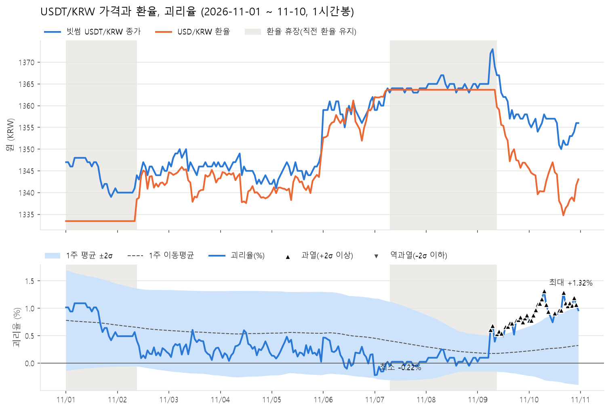
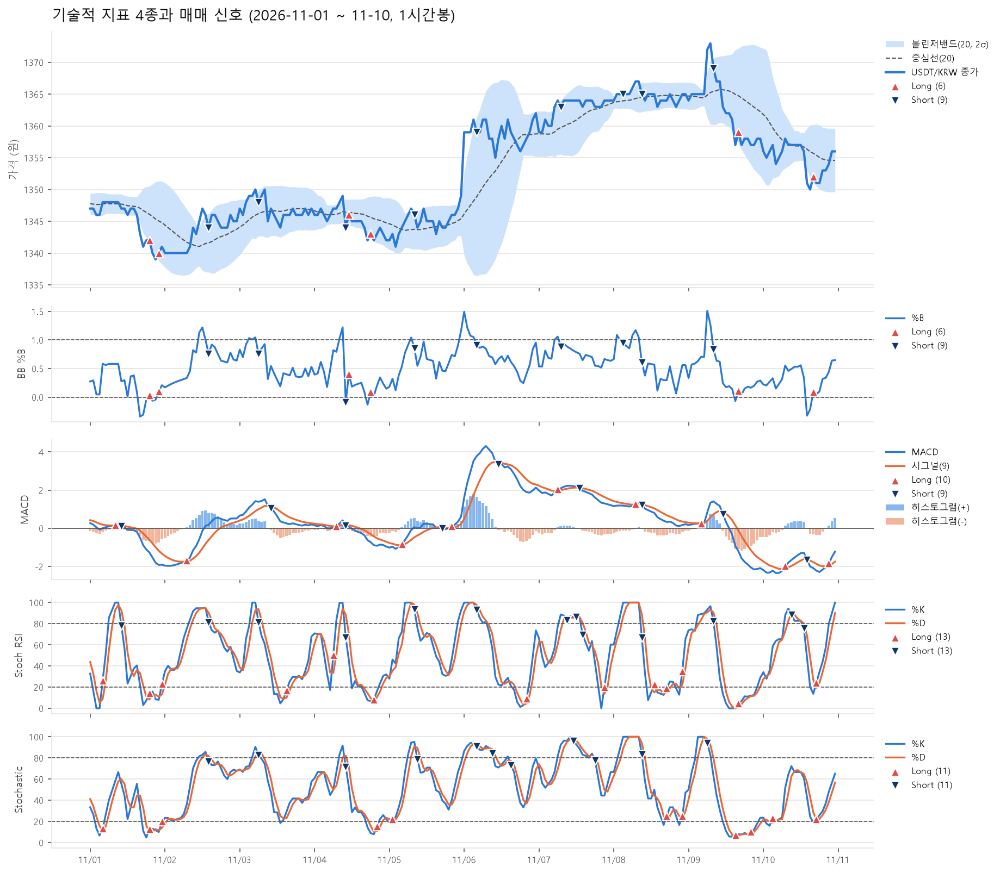
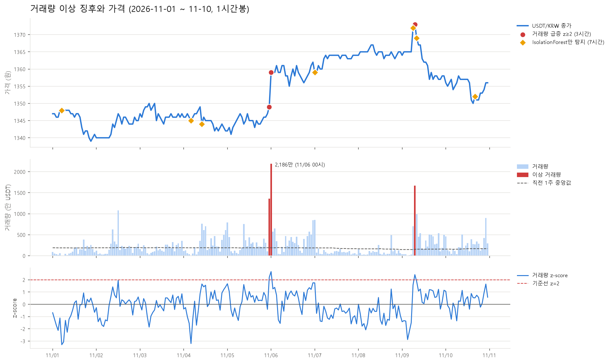
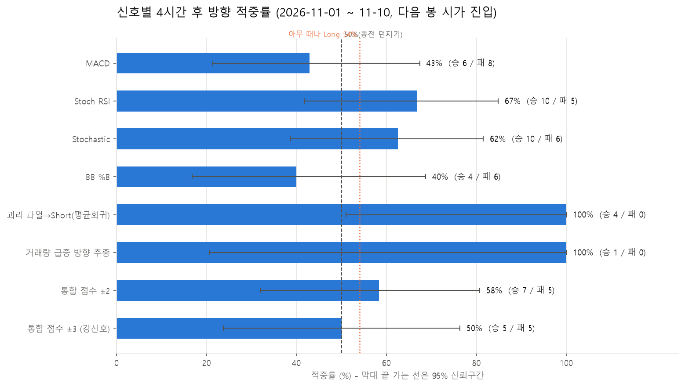
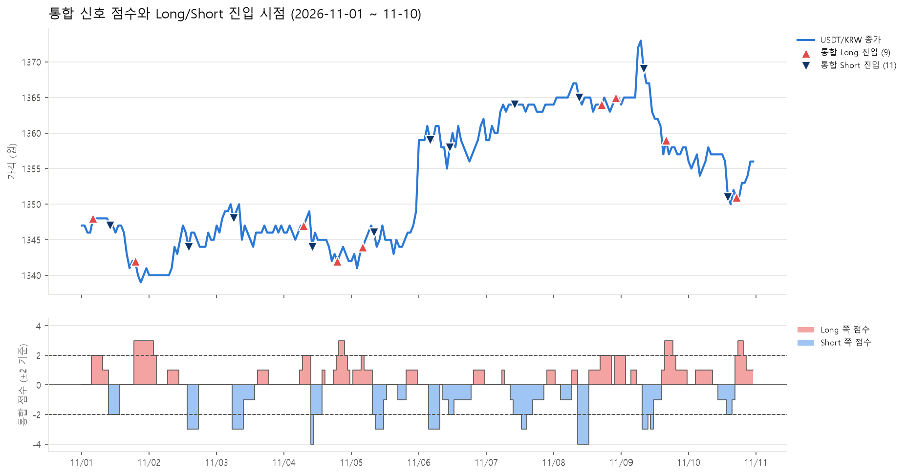

# USDT/KRW 1시간봉 시계열 분석 리포트
### 환율 대비 괴리, 기술적 지표 신호, 거래량 이상 징후로 본 한국 거래소 트레이딩 판단 지원

| 항목 | 내용 |
|---|---|
| 분석 대상 | 빗썸(Bithumb) USDT/KRW 1시간봉 |
| 분석 기간 | 2026-11-01 00시 ~ 2026-11-10 23시 (KST), **240개 데이터 포인트** |
| 보조 데이터 | USD/KRW 환율 1시간봉 (Yahoo Finance `KRW=X`) |
| 분석 기법 | 괴리율(김치 프리미엄)·평균회귀 반감기, MACD, Stochastic RSI, Stochastic, BB %B, 거래량 z-score, IsolationForest, 신호 백테스트 |
| 도구 | Python 3, pandas, numpy, matplotlib, scikit-learn, yfinance, requests |
| 작성일 | 2026-11-20 |

---

## 1. 분석 주제 및 배경

USDT(테더)는 1 USDT ≈ 1 USD를 목표로 하는 스테이블코인입니다. 이론상 한국 거래소의 USDT/KRW 가격은 **USD/KRW 환율과 같아야** 합니다. 하지만 실제로는 국내 수급, 해외 송금 제약, 거래소별 유동성 때문에 환율과 차이(괴리, 이른바 김치 프리미엄)가 생기고, 가격도 기술적 패턴을 보이며 움직입니다.

이 프로젝트는 USDT/KRW 1시간봉 데이터를 세 방향에서 분석해, 한국 거래소에서 **Long(매수)/Short(매도)/Neutral(관망)을 판단할 때 근거가 되는 데이터 기반 지원 시스템**을 만드는 것을 목표로 합니다.

1. **환율 대비 괴리:** USDT가 환율보다 얼마나 비싸거나 싼가, 그 괴리는 되돌아오는가
2. **기술적 지표 신호:** MACD, Stochastic RSI, Stochastic, BB %B 4종의 신호가 실제로 얼마나 맞았는가
3. **거래량 이상 징후:** 거래량 급증이 이후의 큰 움직임을 예고하는가

---

## 2. 분석 질문

| # | 질문 | 유형 |
|---|---|---|
| **Q1** | USDT/KRW는 환율 대비 평균 몇 % 괴리되며, 괴리가 커지면 평균으로 되돌아오는가? | 그래프 확인 + 통계 해석 |
| **Q2** | 4개 기술적 지표 중 어떤 신호가 가장 높은 방향 적중률을 보이며, 지표를 결합하면 신뢰도가 올라가는가? | 추가 해석 필요 (백테스트) |
| **Q3** | 거래량 이상 징후는 이후 가격·괴리의 큰 변동을 예고하는가? | 그래프 확인 + 통계 해석 |
| **Q4** | 분석 기간 마지막 시점(11/10 23시)의 트렌드 판단은 무엇이며, 그 판단의 신뢰성은 몇 %인가? | 추가 해석 필요 (통합 점수) |

---

## 3. 데이터 설명

### 3-1. 출처와 수집 방법

| 데이터 | 출처 | 수집 방법 |
|---|---|---|
| USDT/KRW 1시간봉 | 빗썸 Public API v1 `GET /v1/candles/minutes/60?market=KRW-USDT` | 1회 최대 200개 → `to` 파라미터로 과거 방향 반복 호출 (`src/collect.py`) |
| USD/KRW 환율 1시간봉 | Yahoo Finance `KRW=X` (yfinance 라이브러리) | `yf.download(interval="1h")` (`src/collect.py`) |

- 수집 범위는 **2026-10-25 ~ 11-10 (408개)** 입니다. 앞 7일(168개)은 지표 계산 준비 구간으로만 쓰고, **분석·리포트에는 11/1~11/10의 240개만** 사용했습니다.
- 모든 시각은 **KST(한국시간)** 로 통일했습니다.

### 3-2. 컬럼 구성 (`data/processed/merged_1h.csv`)

| 컬럼 | 설명 |
|---|---|
| `datetime` | 봉 시작 시각 (KST) |
| `open`, `high`, `low`, `close` | USDT/KRW 시가·고가·저가·종가 (원) |
| `volume`, `value` | 거래량(USDT), 거래대금(KRW) |
| `usdkrw` | USD/KRW 환율 |
| `is_filled` | 누락 봉을 채웠는지 여부 |
| `is_ret_outlier` | 가격 급변(1시간 로그수익률 \|z\|>5) 표시 |
| `fx_stale` | 환율 휴장 구간(직전 환율 사용) 표시 |
| `is_analysis` | 분석 기간(11/1~11/10) 여부 |

### 3-3. 데이터 기본 정보와 정제 결과

| 항목 | 값 |
|---|---|
| 분석 기간 | 2026-11-01 00시 ~ 2026-11-10 23시 (KST) |
| 분석 데이터 개수 | 240개 (1시간봉) |
| 전체(준비 구간 포함) | 408개 |
| 논리 오류 제거 | 0건 |
| 빠진 시간대 채움 | 0건 |
| 가격 급변 표시 | 2건 (분석 기간 내 1건) |
| 환율 오류 틱 제거 | 0건 |
| 환율 공백 채움 | 133건 |
| 분석 기간 환율 공백 비율 | 34.6% |
| USDT/KRW 종가 범위 | 1,339 ~ 1,373원 (평균 1,352.9원) |
| USD/KRW 환율 범위 | 1,333.4 ~ 1,363.7원 |
| 최종 결측치 | 0개 |

### 3-4. 결측치·이상치 처리 기준

| 항목 | 기준 | 처리 |
|---|---|---|
| 빗썸 누락 시간대 | 1시간 간격 기준 빈 시각 | 가격은 직전 종가, 거래량은 0으로 채우고 `is_filled` 표시 (결과: 0건) |
| 빗썸 논리 오류 | 고가<저가, 시가·종가가 고저 범위 밖, 가격≤0 | 제거 후 재채움 (결과: 0건) |
| 빗썸 가격 급변 | 1시간 로그수익률 \|z\| > 5 | **삭제하지 않고 표시만** 함 |
| 환율 오류 틱 | 앞뒤 5시간 중앙값과 1% 이상 차이 | 제거 후 직전 값 사용 (결과: 0건) |
| 환율 주말·휴장 | 원본에 값이 없는 시각 | 직전 환율 유지, `fx_stale` 표시 |

**가격 급변 2건 검토 결과**

| 시각 | 변동 | 거래량 | 판단 |
|---|---|---|---|
| 10/30 05시 | +0.82% | 1,718만 USDT | 준비 구간이라 분석 대상 아님 |
| 11/06 00시 | +0.74% (1,350 → 1,359원) | 2,186만 USDT | 같은 시각 환율 급등, 거래량 평소의 11.6배 → **실제 시장 이벤트로 판단해 유지** |

> **수집 과정에서 발견한 문제:** 첫 수집에서는 "빠진 시간대 18건"이 나왔습니다. 원인을 추적해 보니 빗썸 API의 `to` 파라미터를 UTC로 보냈는데, 빗썸은 이를 KST로 해석해 호출마다 **9시간씩 2회 누락**된 것이었습니다. KST 기준으로 수정한 뒤 누락은 0건이 됐습니다.

---

## 4. 분석 방법

### 4-1. 환율 대비 괴리율

- **괴리율(%)** = (USDT/KRW 종가 ÷ USD/KRW 환율 − 1) × 100
- **괴리율 z-score** = (괴리율 − 직전 168시간 평균) ÷ 168시간 표준편차
  - z ≥ +2 → **과열**, z ≤ −2 → **역과열**
- **평균회귀 반감기:** AR(1) 회귀 Δp(t) = a + b·p(t−1)에서 반감기 = −ln2 / ln(1+b) (b<0일 때 회귀)

### 4-2. 기술적 지표 4종

| 지표 | 파라미터 | Long 신호 | Short 신호 |
|---|---|---|---|
| **MACD** | EMA 12, 26 / 시그널 9 | MACD가 시그널선을 상향 돌파 | 하향 돌파 |
| **Stochastic RSI** | RSI 14(Wilder) / Stoch 14 / %K 3 / %D 3 | %K<20 구간에서 %K가 %D 상향 돌파 | %K>80 구간에서 하향 돌파 |
| **Stochastic** | 14 / %K 3 / %D 3 | %K<20 구간 골든크로스 | %K>80 구간 데드크로스 |
| **BB %B** | 20 / 2σ | %B<0 이후 0 이상으로 복귀 | %B>1 이후 1 이하로 복귀 |

> 빗썸 USDT는 1원 단위로 움직여 가격이 몇 시간씩 멈추는 구간이 있습니다. 이때 Stochastic 공식의 분모(최고가−최저가)가 0이 되므로 **중립값(50)으로 처리**했습니다.

### 4-3. 거래량 이상 징후

- **거래량 z-score:** log(거래량)을 **직전** 168시간 평균·표준편차로 표준화했습니다. 현재 봉은 기준에서 제외해, 급증한 봉이 자기 기준을 끌어올리지 않게 했습니다.
  - 기준은 처음에 z ≥ 3으로 잡았으나 **0건**이었습니다(최대 z = 2.66). 그래서 통계에서 흔히 쓰는 **z ≥ 2(상위 약 2.5%)** 로 조정했습니다.
- **IsolationForest(AI 이상 탐지):** 거래량 z, 1시간 가격 변동폭, 1시간 괴리율 변화폭 3개 변수를 함께 사용했고, 상위 3%를 이상치로 지정했습니다.

### 4-4. 통합 점수와 신뢰성 확률(백테스트)

- **통합 점수** = 4개 지표 신호(+1/−1, 발생 후 3시간 유지)의 합 (−4 ~ +4)
  - **+2 이상 → Long, −2 이하 → Short, 그 외 → Neutral**
- **진입 가정:** 신호 봉의 **다음 봉 시가**에 진입합니다(미래 정보 사용 방지).
- **적중 판정:** 진입 후 h시간 뒤 종가가 신호 방향과 같으면 승, 반대면 패, 같으면 보합입니다.
- **신뢰성 확률(적중률)** = 승 ÷ (승 + 패). 표본이 작으므로 **Wilson 95% 신뢰구간**을 함께 표시합니다.
- **비교 기준선:** 분석 기간 아무 시점에나 Long 했을 때의 적중률
- **수수료:** 왕복 0.08%(0.04% × 2)를 가정해 평균 수익률에서 차감했습니다.

---

## 5. 시각화

### 시각화 1. USDT/KRW 가격과 환율, 괴리율


**관찰**
- 11/1~11/8 괴리율은 대부분 **0~0.5%** 범위였습니다. 11/7 00시에는 **−0.22%**(최소, 역프)까지 내려갔습니다.
- **11/9(월) 오전** 환율 시장이 열리자 환율은 약 1,364원에서 1,335원 부근까지 급락했습니다. USDT는 1,373원 고점 뒤 1,350원대까지만 내려가서 괴리율이 **11/10 07시 +1.32%(최대)** 로 벌어졌습니다.
- 과열(▲, +2σ 이상) 35시간은 **모두 11/9~11/10에 몰려** 있습니다.
- 회색 음영(환율 휴장, 직전 환율 사용)은 분석 기간의 34.6%입니다.

### 시각화 2. 기술적 지표 4종과 매매 신호


**관찰**
- 신호 발생 횟수는 Stoch RSI 26회(Long 13 / Short 13), Stochastic 22회(11 / 11), MACD 19회(10 / 9), BB %B 15회(6 / 9) 순입니다.
- **11/9 오전 1,373원 고점:** %B가 약 1.5까지 치솟은 뒤 BB·Stoch RSI·Stochastic·MACD가 **몇 시간 안에 모두 Short**를 냈고, 가격은 11/10 1,351원 부근까지 하락했습니다.
- **11/6~11/8 상승 후 횡보:** 1,360~1,367원에서 오실레이터 계열이 과매수 Short를 여러 번 냈지만, 가격은 사흘간 떨어지지 않았습니다.

### 시각화 3. 거래량 이상 징후와 가격


**관찰**
- 평소 시간당 거래량(중앙값)은 **158만 USDT**이고, 최대는 **11/6 00시 2,186만 USDT(평소의 11.6배)** 입니다.
- z ≥ 2 급증은 **3시간, 사건 2건**입니다. ① 11/5 23시~11/6 00시 상승 돌파 ② 11/9 07시 1,373원 고점.
- IsolationForest는 **8시간**을 이상치로 탐지했고, 11/9 고점 전후와 11/10 1,350원 저점 같은 전환점이 포함됐습니다.

### 시각화 4. 신호별 4시간 후 방향 적중률


**관찰**
- 기준선(아무 때나 Long)은 **54.0%** 입니다. 기간 중 가격이 1,347원에서 1,356원으로 소폭 상승했기 때문입니다.
- Stoch RSI **66.7%**, Stochastic **62.5%** 가 개별 지표 중 가장 높았고, MACD **42.9%**, BB %B **40.0%** 는 50%와 기준선보다 낮았습니다.
- 모든 신호의 95% 신뢰구간이 50%를 포함합니다. **표본이 작아 통계적으로 유의하다고 단정할 수는 없습니다.**

### 시각화 5. 통합 신호 점수와 Long/Short 진입 시점


**관찰**
- 통합 점수 ±2 기준 진입은 **Long 9회, Short 11회**입니다.
- 통합 점수는 대부분 −1 ~ +1(Neutral)에 머물렀고, ±2를 넘는 구간은 짧게 나타났습니다.
- 11/9 고점 직후 Short 진입(1,369원 부근)은 이후 하락과 일치했습니다. 반면 11/8~11/9 횡보 구간의 Long 2회(1,364~1,365원)는 고점 직전의 짧은 반등에 그쳤습니다.

---

## 6. 인사이트

### 인사이트 ① USDT는 환율을 "절반쯤, 늦게" 따라가며, 환율 급락기에 괴리가 커진다
- **관찰(시각화 1):** 괴리율 평균은 **+0.37%**, 중앙값은 **+0.26%**, 표준편차는 **0.36%p** 입니다. 시간당 변동률 상관계수는 **0.61**로, 환율이 USDT 움직임의 약 37%(0.61²)를 설명합니다. 11/9 환율이 약 2% 급락할 때 USDT는 덜 떨어져서 괴리율이 **+1.32%** 까지 확대됐습니다.
- **해석:** 환율 하락은 국내 USDT 가격에 **지연·부분 반영**됩니다. 평일(실시간 환율) 평균 괴리율 +0.38%와 주말(직전 환율) +0.36%가 거의 같아서, 주말 환율 처리 방식이 결론을 왜곡하지 않았습니다.
- **트레이딩 함의:** 환율이 급락하는 날에는 USDT가 뒤따라 내려올 여지가 크므로 **Long 진입을 서두르지 않는 것**이 유리했습니다.

### 인사이트 ② 괴리 "과열"은 괴리 축소가 아니라, USDT 가격 하락으로 이어졌다
- **관찰(시각화 1, 4):** 괴리 과열(+2σ) 진입은 6회입니다. 진입 후 **괴리율은 오히려 더 벌어졌습니다**(6시간 후 +0.07%p, 12시간 후 +0.22%p, 24시간 후 +0.36%p). 평균회귀 반감기도 **13.4시간**(b = −0.050)으로 길었습니다. 하지만 같은 시점에 **USDT 가격 Short는 4시간 후 4승 0패(적중률 100%)**, 수수료 차감 후 평균 **+0.152%** 로 검증 대상 중 가장 좋았습니다.
- **해석:** 괴리 과열은 "USDT가 비싸다"는 뜻이었지만, 해소는 **USDT와 환율이 함께 떨어지면서 환율이 더 빨리 떨어지는** 방식으로 진행됐습니다. 괴리율은 벌어졌어도 USDT 가격 자체는 내려간 것입니다.
- **주의:** 6회 모두 **11/9~11/10 한 번의 하락 국면 안에서** 나왔습니다. 사실상 독립된 사례는 1건이고, 신뢰구간도 51~100%로 넓습니다.

### 인사이트 ③ 개별 지표 신뢰성: Stochastic 계열 > MACD·BB %B
- **관찰(시각화 2, 4) — 4시간 후 적중률**

| 지표 | 승/패/보합 | 적중률 | 95% 신뢰구간 | 수수료 차감 평균 |
|---|---|---|---|---|
| Stoch RSI | 10 / 5 / 11 | **66.7%** | 41.7 ~ 84.8% | −0.041% |
| Stochastic | 10 / 6 / 6 | **62.5%** | 38.6 ~ 81.5% | −0.043% |
| MACD | 6 / 8 / 4 | 42.9% | 21.4 ~ 67.4% | −0.006% |
| BB %B | 4 / 6 / 5 | 40.0% | 16.8 ~ 68.7% | −0.075% |

- **해석:** 이번 기간은 박스권 등락(11/1~11/5)과 계단식 상승·하락이 섞여 있었습니다. 이런 단기 등락에서는 과매수·과매도 되돌림을 잡는 **Stochastic 계열이 유리**했습니다. 추세 추종형 MACD는 전환을 늦게 잡아 불리했습니다. BB %B는 11/6~11/8처럼 밴드 상단에 붙어 오르는 구간에서 Short가 빗나갔습니다.
- **트레이딩 함의:** 단기(4시간) 판단에는 Stoch RSI·Stochastic 신호에 비중을 두되, **보합 비율이 높으므로(Stoch RSI 26회 중 11회)** 1원 단위 가격 구조를 감안해야 합니다.

### 인사이트 ④ 통합 점수의 신뢰성 확률은 58.3%이고, 효과는 12시간 이내로 짧다
- **관찰(시각화 4, 5):** 통합 점수 ±2 신호의 적중률은 보유 시간에 따라 이렇게 달라졌습니다.

| 보유 시간 | 1시간 | **4시간** | 12시간 | 24시간 |
|---|---|---|---|---|
| 적중률 | 56.2% | **58.3%** (7승 5패) | 56.2% | **37.5%** |

  방향별로는 Long **60.0%**(3승 2패), Short **57.1%**(4승 3패)입니다. 4개 지표가 더 많이 일치한 강신호(±3)는 **50.0%** 로 오히려 낮았습니다.
- **해석:** 지표를 결합하면 MACD·BB %B 단독보다 낫고 기준선(54.0%)도 소폭 넘습니다. 그러나 **24시간이 지나면 37.5%로 떨어져**, 이 신호는 반나절 이내의 단기 판단용입니다. 강신호가 더 좋지 않은 것은 표본(10회)이 작은 탓도 있습니다.
- **트레이딩 함의:** 평균 수익률 +0.026%는 왕복 수수료 0.08%를 넘지 못합니다(차감 후 −0.054%). **통합 점수만으로 매매하면 수수료 때문에 손실**이 납니다. 진입 여부 판단의 보조 근거로만 쓰는 것이 적절합니다.

### 인사이트 ⑤ 거래량 급증은 "방향"이 아니라 "큰 움직임이 온다"는 신호다
- **관찰(시각화 3):** 거래량 급증(z ≥ 2) 이후 변동폭은 평상시의 몇 배였습니다.

| 구간 | 가격 변동폭: 급증 후 / 평소 | 괴리 변화폭: 급증 후 / 평소 |
|---|---|---|
| 1시간 후 | **0.344% / 0.075% (4.6배)** | 0.246%p / 0.077%p (3.2배) |
| 4시간 후 | **0.539% / 0.140% (3.9배)** | 0.259%p / 0.137%p (1.9배) |
| 12시간 후 | 0.611% / 0.257% (2.4배) | 0.210%p / 0.199%p (1.1배) |

  방향은 사례마다 달랐습니다. **11/5 23시**(박스권 돌파 직전)는 4시간 후 **+0.89%**, **11/9 07시**(1,373원 고점)는 4시간 후 **−0.73%** 였습니다.
- **해석:** 거래량 급증이 큰 변동을 예고하는 힘은 **4시간 이내에 가장 강하고**, 12시간이 지나면 평소 수준으로 돌아옵니다. 방향은 **위치**가 결정합니다. 박스권을 돌파할 때 터지면 추세가 지속됐고, 이미 오른 고점에서 터지면 반락했습니다.
- **트레이딩 함의:** 거래량 급증 시점에는 **손절폭을 넓히거나 포지션을 줄이는 변동성 경보**로 활용하고, 방향은 지표 신호와 위치로 판단해야 합니다.

### 인사이트 ⑥ 가장 신뢰할 만한 장면은 "거래량 급증 + 지표 동시 신호 + 괴리 과열"이 겹친 순간이었다
- **관찰(시각화 1~3, 5):** 11/9 07시 1,373원 고점에서는 ① 거래량이 평소의 11.0배(z = 2.41)로 급증했고 ② 4개 지표가 수 시간 안에 모두 Short를 냈으며 ③ 괴리율이 과열로 진입했습니다. 이후 가격은 하루 만에 **약 1.6%(1,373 → 1,351원)** 하락했습니다.
- **해석:** 세 가지 분석 축이 **같은 방향을 가리킬 때** 판단의 근거가 가장 강했습니다. 반대로 한 축만 신호를 낸 11/6~11/8 횡보 구간에서는 Short 신호가 연달아 빗나갔습니다.

---

## 7. 질문별 답변 요약

| 질문 | 답변 |
|---|---|
| **Q1** 괴리 크기와 평균회귀 | 평균 **+0.37%**(범위 −0.22 ~ +1.32%)입니다. 반감기 **13.4시간**으로 회귀하는 힘이 약했고, 과열 후 괴리는 오히려 확대됐습니다. 다만 같은 시점의 USDT 가격 Short는 4승 0패였습니다(인사이트 ①②). |
| **Q2** 지표 신뢰도와 결합 효과 | 4시간 적중률은 Stoch RSI **66.7%** > Stochastic **62.5%** > MACD 42.9% > BB %B 40.0%입니다. 통합 점수 ±2는 **58.3%** 로 약한 지표보다는 낫지만, 강신호(±3)가 더 낫지는 않았습니다(인사이트 ③④). |
| **Q3** 거래량 급증의 예고력 | **예고합니다.** 급증 후 4시간 가격 변동폭은 평소의 **3.9배**입니다. 단, 방향은 예고하지 않습니다(인사이트 ⑤). |
| **Q4** 마지막 시점 판단 | 11/10 23시 통합 점수는 **+1**(MACD +1, 나머지 0) → **Neutral(관망)** 입니다. ±2 기준에 못 미쳐 신뢰성 확률을 부여할 신호가 없습니다. 가격이 1,350원 저점에서 1,356원으로 반등 중이라, **Long 쪽으로 기울고 있으나 확인 신호를 기다려야 하는 상태**입니다. |

---

## 8. 결론

1. **환율 대비 괴리는 USDT/KRW 판단의 출발점입니다.** USDT는 환율을 지연·부분 반영해서, 환율이 급변하면 괴리가 벌어집니다. 괴리 과열은 "괴리 축소"를 기대하기보다 **USDT 가격 하락 신호**로 해석하는 것이 이번 표본에서는 맞았습니다.
2. **단기 판단에는 Stochastic 계열 지표가 가장 유용했습니다.** 4개 지표를 합친 통합 점수의 신뢰성 확률은 **58.3%(4시간)** 로 기준선(54.0%)을 소폭 넘지만, **수수료를 넘는 수익을 내지는 못했습니다.**
3. **거래량 급증은 강력한 변동성 경보입니다.** 4시간 내 변동폭이 평소의 약 4배라서, 방향 판단보다는 **포지션 크기·손절폭 조정**에 쓰는 것이 적절합니다.
4. **세 축(괴리·지표·거래량)이 동시에 같은 방향을 가리킬 때** 가장 신뢰할 만한 판단 근거가 됐습니다(11/9 고점 사례).

**판단 지원 규칙 제안(이번 분석 기반)**

| 상황 | 판단 |
|---|---|
| 통합 점수 ±2 이상 + 괴리 과열 + 거래량 급증이 같은 방향 | 해당 방향 **우선 검토** |
| 통합 점수 ±2 이상만 단독 발생 | 참고만 (적중률 58%, 수수료 감안 시 기대수익 음수) |
| 거래량 급증 단독 | 방향 판단 보류, **변동성 확대 대비** |
| 통합 점수 −1 ~ +1 | **Neutral(관망)** |

---

## 9. 한계점

1. **짧은 표본 기간:** 10일(240시간)은 시장 국면 하나 반 정도에 불과합니다. 신호별 표본이 10~20회라 **모든 적중률의 95% 신뢰구간이 50%를 포함**하며, 통계적 유의성은 확보하지 못했습니다.
2. **사건 집중:** 괴리 과열 6회와 그 Short 적중 4회가 모두 11/9~11/10 한 번의 하락 국면에서 나왔습니다. 다른 국면에서도 같은 결과가 나올지는 검증되지 않았습니다.
3. **환율 데이터 공백:** 분석 기간의 34.6%(주말·휴장)는 직전 환율을 사용해서, 그 시간대 괴리율은 실시간 값이 아닙니다.
4. **1원 단위 가격 구조:** 가격이 자주 멈춰서 보합 비율이 높습니다(Stoch RSI 26회 중 11회). 보합을 제외한 적중률은 실제 체감보다 높게 보일 수 있습니다.
5. **기준값 선택:** 거래량 기준을 z ≥ 3에서 z ≥ 2로, 통합 점수 기준을 ±2로 정한 것은 이번 데이터를 보고 결정했습니다. **같은 데이터로 기준을 정하고 검증했으므로 과최적화 가능성**이 있습니다. 다른 기간에서 다시 검증해야 합니다.
6. **거래 비용:** 왕복 수수료 0.08%만 반영했고, 슬리피지(호가 차이)와 거래소 수수료 등급 차이는 반영하지 않았습니다.
7. **외부 요인 미반영:** 해외 거래소 USDT 가격, 김치 프리미엄에 영향을 주는 규제·뉴스, 비트코인 등 다른 자산 흐름은 포함하지 않았습니다.

> 본 리포트는 데이터 분석 학습과 의사결정 지원 시스템 구축을 위한 자료이며, **투자 권유가 아닙니다.**

---

## 10. 재현 방법

```bash
pip install -r requirements.txt
python src/collect.py      # STEP 1  데이터 수집 (빗썸 + 환율)
python src/clean.py        # STEP 2  정제·병합
python src/premium.py      # STEP 3  괴리율 분석 → images/01
python src/indicators.py   # STEP 4  기술적 지표 4종 → images/02
python src/anomaly.py      # STEP 5  거래량 이상 징후 → images/03
python src/backtest.py     # STEP 6  통합 점수·신뢰성 확률 → images/04, 05
```

단계별 상세 수치는 `data/processed/` 폴더의 `data_summary.md`, `premium_stats.md`, `indicator_stats.md`, `anomaly_stats.md`, `backtest_stats.md`에 저장됩니다.
